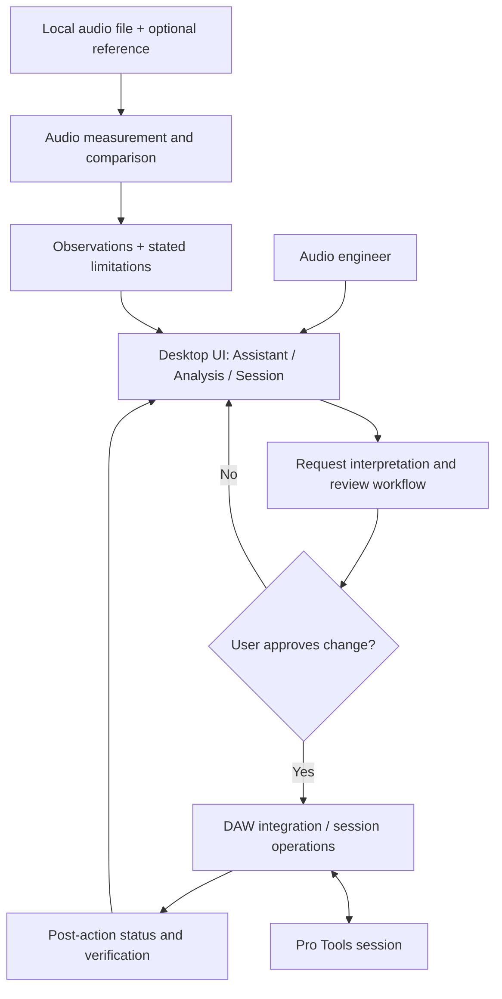

# LUZ Engineer

**AI-Assisted Audio Engineering & DAW Automation**  
**Independent software project · Amine Mahlah · Active development**

> A desktop assistant exploring safe automation of digital audio workstation workflows and evidence-based audio analysis. This is a public technical showcase; the proprietary application source code is not published.

## Product walkthrough

### 1. Assistant and DAW connection

The interface exposes a session-aware assistant and shows a connected state. A connection indicator alone does not establish that every command is supported.

### 2. Reviewed command execution

Example request: **“crée 1 piste audio”**. The application displays an audio track and a **“Changes applied and verified”** result. The workflow is designed around preview/review and explicit application, rather than unrestricted autonomous editing. The screenshot documents this particular successful run, not universal command reliability.

### 3. Audio analysis and reference comparison

The application analyzes a local audio bounce and supports an optional reference file. In the example, the UI reports **“comparable with limitations”** and observations about stereo characteristics and energy distribution. Comparability limits are explicitly communicated.

### 4. Inspectable measurements

The visible test bounce is a **6.00 s, 48 kHz, 24-bit stereo WAV**. Displayed measurements include **−18.15 dBFS sample peak, −33.27 dBFS RMS, −30.3 LUFS integrated loudness**, crest factor, stereo correlation, DC offset, and frequency-band summaries. These are example measurements from a particular file, not performance benchmarks.

### 5. Session overview and uncertainty handling

The interface displays a connected **17-track** session and proposed track families. Nine tracks are marked for review; the application asks for human confirmation when name-based categorization is uncertain rather than silently treating guesses as facts.

## The engineering problem

DAW work includes repeated technical operations—organizing tracks, checking sessions, analyzing bounces, and interpreting measurements. Automation can save time, but a mistaken change to an active session can disrupt creative work. The challenge is therefore **reliability and user control**, not merely speed.

## Conceptual architecture

The diagram below is a **high-level functional model inferred from the visible workflows and project development context**, not a verified inventory of internal classes, services, languages, or deployment infrastructure.

### Functional boundaries

| Area | Role | Evidence / limitation |
|---|---|---|
| Desktop interface | Assistant, analysis, session views | Shown in screenshots |
| DAW integration | Session inspection and controlled operations | Connection, track view, and a verified action shown; not all commands validated |
| Audio analysis | Measurements and reference comparison | Local-file analysis and results shown |
| Review and validation | Preview/approval and post-action feedback | Shown for the track-creation example |
| Uncertainty management | Requests confirmation for ambiguous classification | Nine tracks marked for review in screenshot |

## AI-assisted engineering workflow

AI coding agents assist with implementation and iteration. Human responsibilities include defining requirements, selecting acceptable behavior, reviewing proposed changes, checking evidence, and deciding whether a milestone is ready. The project emphasizes reproducible testing, explicit limitations, and controlled interactions with external software.

**Important distinction:** AI-assisted *development* is not the same as claiming the application already contains a fully autonomous generative-AI agent. This showcase does not make that claim.

## Engineering challenges and lessons

1. **External application state:** an active DAW is stateful; operations need checks and verification instead of optimistic success messages.
2. **Trustworthy audio feedback:** numeric measurements should be inspectable, and reference comparisons should disclose limitations.
3. **Ambiguous user intent:** classifying tracks by name can be uncertain; a review step is safer than unconfirmed automatic organization.

## Current status and scope

This is an **in-development prototype**. The screenshots illustrate selected working paths; they do not establish complete production readiness, unrestricted DAW automation, or comprehensive real-world compatibility. Some integration scenarios remain subject to validation.

## What I would improve next

Strengthen end-to-end validation against representative DAW sessions, broaden negative/error-path coverage, and improve the traceability from user request to proposed change, execution, and observed result.

## Related work

[Luz Entertainment](https://luzentertainment.com) — a separate public-facing web project involving forms, integrations, automation, and analytics.

## Source availability

The underlying software is proprietary. This repository contains **documentation and screenshots only**—no application binaries, credentials, private source code, or confidential client materials.
